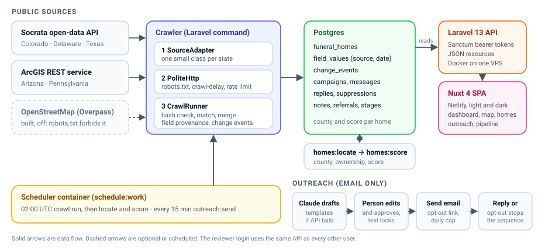

# Funeral Home Referral Finder

Laravel 13 · Nuxt 4 · Postgres · Docker on one VPS · 5 states · about 2,450 homes · 93 tests
App: https://funeral-referral.netlify.app · Reviewer login: reviewer@funerals.com

## How it's built

It's a Laravel API and a Nuxt single-page app, with Postgres, all running in Docker on one small server. A scheduler container does the nightly crawl and sends approved emails.

The main thing I wanted was for states to be cheap to add. Each state is one small adapter class that turns that state's data into a common record. The crawler, matcher and change detection don't know which state they're looking at, so a new state never touches them.

Every request goes through one wrapper that reads and caches the host's robots.txt, respects crawl-delay, and refuses to fetch anything disallowed. Every value is saved with the source and date it came from, and the profile page shows both.

## Sources and limits

| State | Source | Format | Rows per run |
|---|---|---|---:|
| CO | DORA funeral homes | Socrata | 269 |
| DE | Funeral establishments | Socrata | 151 |
| TX | Prepaid funeral contract sellers | Socrata | 211 |
| AZ | ADHS homes and crematoriums | ArcGIS | 172 |
| PA | Funeral home layer (pa.gov GIS) | ArcGIS | 1,485 |

I left Nevada out because its robots.txt blocks everything. I also built an OpenStreetMap adapter but switched it off, because the public servers disallow API access. That means most homes come from a single source, so cross-source matching does less than I'd hoped. I never needed an HTML, CSV or PDF adapter, since every state that allowed crawling has an API.

The data is thin. About 77% of homes have unknown ownership, because Pennsylvania, Colorado and Delaware publish no owner, website or phone. Only about 26 homes have an email. Texas lists corporate entities rather than storefronts, and most Texas rows have no ZIP. Arizona and Pennsylvania give no licence status, and I didn't build closure detection for a record disappearing. The county map uses ZIP codes and covers 88% of homes.

## Matching and change detection

A new record is matched to an existing home by, in order: the same licence number; the same phone and a similar name; the same website and a similar name; or a very similar name in the same town or close on the map. If the street numbers differ, the fuzzy rules never merge, because two funeral homes on one street is common. I'd rather leave a duplicate someone can see than merge two real homes and hide one.

Each record gets a hash, so unchanged rows are skipped. When something differs it becomes an event: new home, new licence, status change, closure, or a new website, phone, email, address or owner. Each source's first crawl is hidden from "changed this week", otherwise the first import would show up as thousands of new homes.

**Evidence:** the scheduler has run on its own every night since Nov 1 (five sources a night, all on the Crawl runs page). On Nov 3 the Texas run stopped itself on a robots.txt refusal and recovered the next night. No register has changed since Nov 2, so "changed this week" is empty for now. The changes logged on Nov 1 and 2 came from my own re-processing after I changed the hashing, so I hid them behind a baseline.

## Scoring and outreach

Each home is classed as chain, family-owned, independent or unknown. Chain means a known brand, or 8 or more locations under one operator. With no data, it says unknown instead of guessing.

| Partner score, out of 100 | Points |
|---|---:|
| Ownership: independent or family 30, unknown 10, chain 0 | 30 |
| Licence active 20 (listed without status 12) | 20 |
| Offers pre-need | 15 |
| Phone 10, website 5, email 5, director 5, address 5 | 30 |
| Confirmed by two or more sources | 5 |

Closed homes score 0, and every profile lists each factor and why it earned its points. The weights are my own judgement. I have no referral outcomes yet to test them against, so they live in one config file and are easy to change.

For outreach, Claude drafts a first email, two follow-ups (day 4 and day 10) and a call script, with separate versions for independents and chains. If the API fails, templates are used. Nothing is sent until a person edits and approves it, and after approval the text is locked. Only emails are ever sent, never calls or texts. Each one has a one-click unsubscribe link and a postal address, suppression is checked again just before sending, and a reply or opt-out stops the sequence.

## With another month

First, find emails and owners from the homes' own websites (checking robots.txt), because that's what limits outreach most. Then adapters for states that only publish HTML or PDF, and closure detection. After that, real inbound email so replies are logged automatically, and tuning the score against actual referrals.

## Where AI helped, and where it got things wrong

I built this with Claude Code, and it wrote most of the code and tests. I picked the stack and hosting, and I deployed and checked it on the server myself. It saved a lot of time on the adapters, the deploy and the UI.

It got several things wrong. They only showed up on real data, because the tests passed each time, so every fix came with a new test:

- It assumed OpenStreetMap could be crawled. Its robots.txt said no.
- Delaware lists some licences on several rows, so the crawler reported fake changes every night until the adapter was fixed.
- The matcher merged two homes that differed only in house number.
- The first crawl filled "changed this week" with every home as new.
